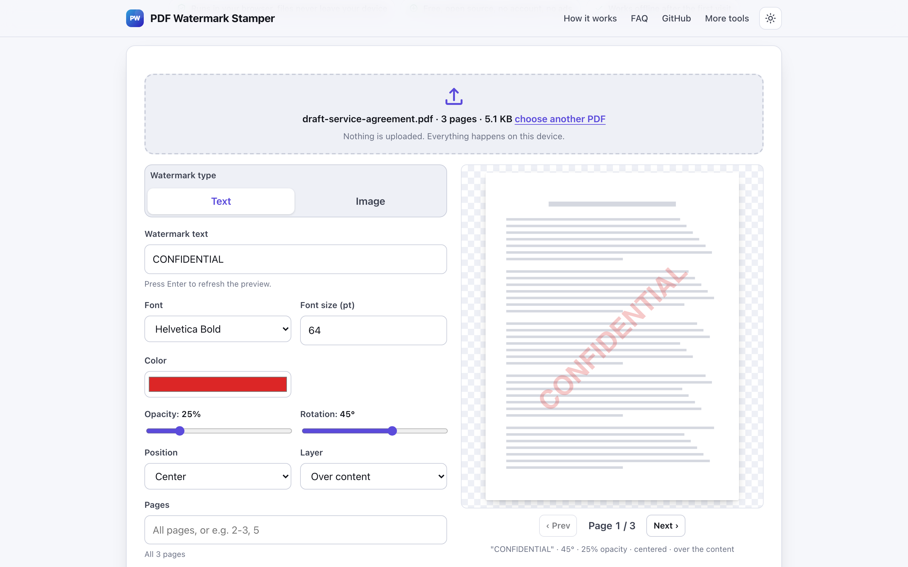
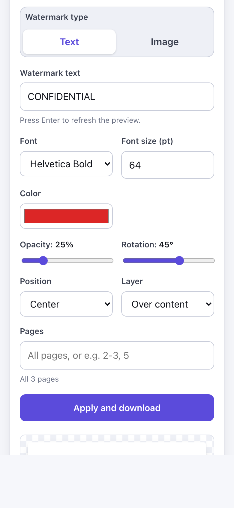

# PDF Watermark Stamper

> Add a text or image watermark like CONFIDENTIAL to every PDF page in your browser, with no upload.

**🌐 Use it now: [turhe123.github.io/pdf-watermark-stamper](https://turhe123.github.io/pdf-watermark-stamper/)** · free · open source · runs in your browser · works offline


## Why

PDF Watermark Stamper is a free, open-source alternative to tools like Smallpdf and iLovePDF Watermark PDF, which upload your documents, apply daily free limits and keep batch and image stamps on a paid plan. Here your files never leave your device, there is no account, no ads and no limits, it works offline, and you can install it as an app.

## Screenshots

<p align="center"></p>

<p align="center"><em>PDF Watermark Stamper in the browser, light theme</em></p>

<p align="center"></p>

<p align="center"><em>PDF Watermark Stamper on a phone</em></p>

## Features

- Text watermark: any text (default `CONFIDENTIAL`, up to 120 characters), in Helvetica Bold, Times Bold or Courier Bold, size 6 to 400 pt (default 64), with a color picker (default red).
- Image watermark: stamp a PNG or JPG logo, with an image-width slider (5 to 100% of the page width). Transparent PNGs keep their transparency.
- Large images are downscaled to 2000 px on the longest side before embedding, to keep the PDF small.
- Opacity slider (5 to 100%, default 25%) and rotation slider (-180 to 180 degrees, default 45).
- Position: centered, or tiled across the whole page.
- Layer: draw the stamp over or under the page content.
- Page range such as `2-3, 5`; pages outside the range stay unmarked. Invalid ranges are reported inline.
- Live preview on a schematic page, using the same placement math as the output, with a page stepper. Press Enter in the text field to refresh it.
- Non-Latin text (for example Hebrew, Arabic, Chinese or emoji) cannot be drawn with the standard PDF fonts, so a button turns the text into a transparent image watermark instead.
- Stamping runs in a Web Worker with a progress bar; the result shows how many pages were stamped and the file size.
- The download is named `name_watermarked.pdf`.
- Errors (not a PDF, damaged file, encrypted file, bad range, unreadable image) are shown inline.
- Light and dark themes, keyboard accessible, layout works at 390 px wide.

**Formats and limits**

- Input: one PDF at a time. Encrypted or password-protected PDFs are not supported.
- Watermark image: PNG or JPG.
- Output: a PDF. It only adds a watermark; it does not remove watermarks or edit other content.
- Size limits depend on your browser's available memory.

## How to use

1. Drop a PDF on the page or choose one.
2. Pick Text or Image, then set the text or choose a logo, plus opacity, rotation, position and layer.
3. Optionally enter a page range, and step through the pages in the preview.
4. Click **Apply and download** to save `name_watermarked.pdf`.

## Privacy

- Nothing is uploaded. The PDF and any logo are processed in your browser and never sent to a server.
- No cookies.
- Page views are counted anonymously with [GoatCounter](https://www.goatcounter.com/) (cookieless, open source). Nothing else is sent.
- After the first visit a service worker caches the page, so it works offline.

## Run it locally

```bash
git clone https://github.com/turhe123/pdf-watermark-stamper
cd pdf-watermark-stamper
python3 -m http.server 4173
```

Then open http://127.0.0.1:4173/. There is no build step.

## Tests

```bash
npm i -D @playwright/test && npx playwright install chromium
npx playwright test
```

## Third-party code

- [pdf-lib](https://pdf-lib.js.org/) 1.17.1, MIT license (`vendor/pdf-lib/`).

## Built with AI

PDF Watermark Stamper was written by [Claude Code](https://claude.com/claude-code) inside an automated pipeline, from a plain-English spec. No code or assets from any commercial product were used; it is a clean-room implementation of a feature set, not a copy.

What that means in practice:

- The full source is in this repo under the MIT license. Read it before you trust it with your files.
- Everything runs in your browser. It makes no network requests except an anonymous, cookieless page-view count (GoatCounter); your files never leave the device.
- The page is tested headless in Chromium (Playwright) before every release, but it has had less human review than hand-written software. Bug reports and pull requests are welcome.

## Support ❤️

If this saved you a subscription, you can say thanks on [Ko-fi](https://ko-fi.com/leodavidai).

## More free web tools

See [turhe123.github.io/web-tools](https://turhe123.github.io/web-tools/).

## License

MIT © Or Davidai Bachar
